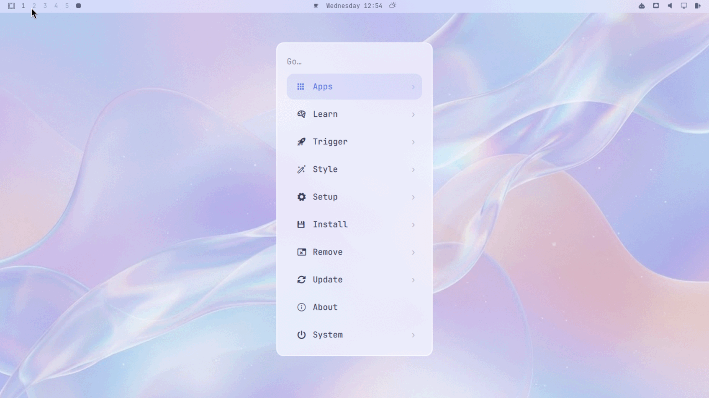

# Liquid Glass

A calm, light [Omarchy](https://omarchy.org) theme of frosted glass over soft lavender, periwinkle and rose.



## Install

From the Omarchy menu, go to _Install > Style > Theme_ and paste this repo's URL, or run:

```bash
omarchy theme install https://github.com/ricardoborges/omarchy-liquid-glass-theme
```

Then pick **Liquid Glass** with `Super + Ctrl + T`. Cycle the three backgrounds with `Super + Ctrl + W`.

## What you get

- A light palette with a periwinkle accent and pastel ANSI colors, applied to the terminals, Neovim, btop, VS Code and the rest of the apps Omarchy themes
- A translucent bar, menu, launcher, notifications and popups with soft white borders
- A periwinkle-to-rose gradient on the active window border
- Three backgrounds: liquid ribbons, glass peaks and a soft aurora

## Getting the full glass effect

Omarchy never runs `.lua` files from a theme installed from a git repo, so this theme's `hyprland.lua` is skipped on install. That file adds the rounded corners, the soft lavender shadow, and the blur behind the translucent shell surfaces. Without it the shell is still see-through, just not frosted.

Omarchy's own settings get you most of the way. In the Omarchy menu, under _Appearance_:

- _Menu Bar > Bar Background > Glassy Bar_ frosts the bar
- _Windows > Window Opacity > Glassy Windows_ frosts the windows and the other shell surfaces
- _Windows > Rounded Corners_ rounds the windows and the shell

The soft lavender shadow is the one piece left. To add it, read [`hyprland.lua`](hyprland.lua), then copy its `shadow` block into `~/.config/hypr/looknfeel.lua`:

```lua
hl.config({
  decoration = {
    shadow = {
      enabled = true,
      range = 18,
      render_power = 3,
      color = "rgba(7a86c833)",
      color_inactive = "rgba(7a86c41a)",
    },
  },
})
```

## Requirements

The backgrounds are WebP, which the Omarchy shell decodes through `qt6-imageformats`. Current Omarchy installs it; on an older system, run `omarchy-pkg-add qt6-imageformats && omarchy-restart-shell`.

## License

[MIT](LICENSE)
